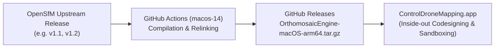

# OpenSfM Engine: macOS arm64 Distribution Pipeline

Automated packaging and distribution pipeline for upstream [OpenSfM](https://github.com/OpenSfM/OpenSfM) targeting macOS Apple Silicon (`arm64`).

This repository contains **no custom fork modifications**; it functions purely as an automated packaging engine to compile OpenSfM, Ceres Solver, OpenCV, and Python 3.10 into standalone, relocatable macOS archives for consumption by host applications (such as `ControlDroneMapping.app`).

---

## Architecture Overview



1. **Standalone Packaging**: Keeps CI automation, lockfiles, and packaging scripts cleanly separated from upstream source code.
2. **Hermetic Builds**: Locked dependencies (`conda-osx-arm64.lock`, `requirements-runtime.lock`, `requirements-build.lock`) ensure reproducibility across builds.
3. **Dynamic Library Relocation**: All Mach-O binaries (`.so`, `.dylib`, executables) have absolute dependencies rewritten to `@loader_path/`, making the runtime completely relocatable across machines.
4. **Sandboxed Helper Compliance**: Packages `OrthomosaicPython` carrying `com.apple.security.inherit` and `com.apple.security.app-sandbox` entitlements with identifier `com.hata.ControlDroneMapping.engine.python`.
5. **Zero Local Compilation**: Host applications download pre-compiled releases and apply local developer identity inside Xcode in seconds.

---

## Workflows

### 1. `Build & Package OpenSfM Engine (macOS arm64)`
- **File**: [`.github/workflows/build-and-release.yml`](.github/workflows/build-and-release.yml)
- **Triggers**:
  - Pushing any version tag matching `v*` (e.g. `v1.1`, `v1.2`).
  - Manual trigger via **Run workflow** (`workflow_dispatch`) with custom `version_tag` and `upstream_ref`.
- **Outputs**:
  - `OrthomosaicEngine-macOS-arm64.tar.gz`
  - `OrthomosaicEngine-macOS-arm64.tar.gz.sha256`

### 2. `Auto-Detect Upstream OpenSfM Releases`
- **File**: [`.github/workflows/auto-detect-upstream-release.yml`](.github/workflows/auto-detect-upstream-release.yml)
- **Triggers**:
  - Automatically runs on any **push to `main`**.
  - Daily cron schedule at `00:00 UTC`.
  - Manual one-click check (`workflow_dispatch`).
- **Function**:
  - Reads baseline threshold from [`Config/min-upstream-version.txt`](Config/min-upstream-version.txt) (`v1.1`).
  - Queries upstream tags on `https://github.com/OpenSfM/OpenSfM.git`.
  - Automatically triggers `build-and-release.yml` for any release `>= v1.1` that has not yet been built in this repository.

---

## Fully Automated Operation (Zero Manual Tagging)

1. **Initial Baseline Release (`v1.1`)**:
   - Simply push this repository to GitHub:
     ```bash
     git add .
     git commit -m "feat: setup automated OpenSfM macOS arm64 CI release pipeline"
     git push -u origin main
     ```
   - Pushing to `main` automatically fires `auto-detect-upstream-release.yml`.
   - The detector finds upstream `v1.1`, notes that no release exists yet in this repo, and automatically triggers `build-and-release.yml`.
   - No manual tag push or UI click required!

2. **Future Upstream Releases (`v1.2`, `v2.0`, etc.)**:
   - When upstream OpenSfM tags a new release, the daily cron automatically detects it within 24 hours, builds it, and publishes the release.

---

## Repository Structure

```text
.
├── .github/
│   └── workflows/
│       ├── build-and-release.yml             # Primary macOS compilation & release workflow
│       └── auto-detect-upstream-release.yml  # Daily detector for new upstream tags
├── Config/
│   ├── min-upstream-version.txt              # Baseline threshold for detector (v1.1)
│   ├── conda-osx-arm64.lock                  # Pinned native dependencies
│   ├── requirements-runtime.lock             # Pinned pip runtime wheels with checksums
│   └── requirements-build.lock               # Pinned pip build dependencies
├── Scripts/
│   └── prepare-distribution-engine.py        # Relinks rpaths to @loader_path, prunes headers, signs
├── .gitignore
└── README.md
```
